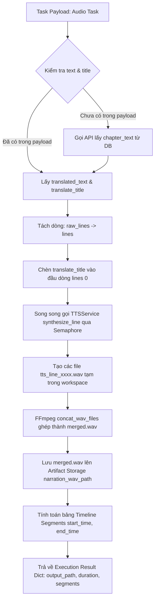

# AudioExecutor — Tài Liệu Đặc Tả Kỹ Thuật

`AudioExecutor` là Executor đảm nhiệm task stage `audio` trong Worker (`distributed-video-system-worker`). Executor này chịu trách nhiệm chuyển đổi toàn bộ văn bản chương truyện tiếng Việt thành giọng đọc (Text-To-Speech - TTS), ghép nối thành file âm thanh thuyết minh (narration WAV) và xây dựng bảng timeline timestamps (phục vụ khớp phụ đề và hình ảnh trong video sau này).

---

## 1. Mục Đích & Vị Trí Trong Hệ Thống

Sau khi `TextExecutor` hoàn thành việc crawl, clean và dịch văn bản sang tiếng Việt, `AudioExecutor` tiếp nhận kết quả để:
1. **Tổng hợp giọng đọc AI (TTS)**: Đọc từng câu/dòng truyện bằng mô hình TTS (ONNX / Piper), kiểm soát tốc độ đọc (`speed`).
2. **Tự động gắn tiêu đề chương (`translate_title`)**: Đọc tiêu đề chương mở đầu trước khi đọc nội dung câu chuyện.
3. **Ghép nối âm thanh chuẩn studio**: Sử dụng FFmpeg ghép tất cả các đoạn âm thanh từng dòng thành một file WAV duy nhất (`merged.wav`), đảm bảo không ngắt quãng hoặc méo tiếng.
4. **Tạo bảng Timeline Segments**: Ghi lại mốc thời gian bắt đầu (`start_time`), kết thúc (`end_time`) và thời lượng (`duration`) của từng dòng để `GenerateVideoExecutor` căn chỉnh phụ đề và hoạt họa chính xác đến từng mili-giây.

---

## 2. Luồng Xử Lý (Workflow)



---

## 3. Đặc Tả Dữ Liệu Đầu Vào (Input Contract)

Executor nhận `task` (chứa `task.payload`) và `runtime_context` (`ChapterRuntimeContext`).

### Các trường trong `task.payload`:

| Tên trường | Kiểu dữ liệu | Bắt buộc | Mặc định | Mô tả |
| :--- | :--- | :--- | :--- | :--- |
| `translated_text` / `final_script` | `string` | Có (hoặc có trong DB) | `""` | Toàn bộ nội dung văn bản tiếng Việt của chương truyện. |
| `translate_title` / `translated_title` | `string` | Không | `None` | Tiêu đề chương đã dịch tiếng Việt (sẽ được chèn vào dòng đầu để đọc). |
| `speed` | `float` | Không | `1.0` (từ settings) | Tốc độ giọng đọc TTS (ví dụ: `1.0`, `1.1`, `1.15`). |
| `chapter_id` | `string` | Không | `None` | ID chương trong DB (dùng để fallback tải text từ API nếu payload thiếu). |
| `chapter_source_id` | `string` | Không | `None` | ID nguồn chương (dùng fallback API). |

---

## 4. Xử Lý Tiêu Đề Chương (`translate_title`)

Nhằm đồng bộ với `TextExecutor` (nơi đã bóc tách tiêu đề ra khỏi phần nội dung):
- `AudioExecutor` nhận `translate_title = payload.get("translate_title") or payload.get("translated_title")`.
- Nếu có giá trị, tiêu đề sẽ tự động được chèn vào vị trí đầu tiên của danh sách dòng cần đọc (`lines.insert(0, title_line)`).
- Có cơ chế kiểm tra chống lặp: Nếu dòng đầu tiên của `translated_text` đã trùng với tiêu đề, hệ thống sẽ không chèn thêm lần nữa.
- Tiêu đề sẽ được đọc ở phân đoạn đầu tiên: `line_index: 0`, `start_time: 0.0`.

---

## 5. Đặc Tả Dữ Liệu Đầu Ra (Output Contract)

Khi hoàn thành, phương thức `execute()` trả về một `dict` gồm các trường sau:

| Tên trường | Kiểu dữ liệu | Mô tả |
| :--- | :--- | :--- |
| `output_path` | `str` | Đường dẫn file âm thanh hoàn chỉnh trên Artifact Storage (`batches/<batch_id>/chapters/<chapter_num>/tts/merged/narration.wav`). |
| `duration` | `float` | Tổng thời lượng audio narration tính bằng giây (làm tròn 3 chữ số thập phân). |
| `segments` | `list[dict]` | Danh sách chi tiết mốc thời gian của từng dòng (xem cấu trúc bên dưới). |

### Cấu trúc từng phần tử trong `segments`:
```json
{
  "line_index": 0,
  "line_text": "Chương 1 Đại hội tông môn",
  "start_time": 0.0,
  "end_time": 2.45,
  "duration": 2.45
}
```

---

## 6. Cơ Chế Điều Phối & Hiệu Năng TTS (Concurrency)

- **Worker Semaphore**: Quá trình tổng hợp từng dòng `synthesize_line` chạy đồng thời thông qua `asyncio.gather`, nhưng được điều phối bởi một `Semaphore` dùng chung toàn worker (`settings.tts.max_concurrency`, mặc định 3 luồng đồng thời) để tránh quá tải GPU/CPU.
- **Ghép nối tối ưu**: `concat_wav_files` sử dụng FFmpeg với `concat demuxer` (không cần re-encode âm thanh nếu định dạng tương đồng), hỗ trợ GPU acceleration khi có cờ `runtime_context.gpu_available`.
- **Dọn dẹp & Lưu trữ**: Các file tạm `tts_line_xxxx.wav` và `merged.wav` được tạo trong thư mục `workspace_dir` riêng của attempt, sau đó file tổng được upload lên `ArtifactStorage`.

---

## 7. Xử Lý Ngoại Lệ (Exceptions)

- `RuntimeError("Cannot load chapter text: ...")`: Không có text trong payload và API client không tìm thấy text trong DB.
- `RuntimeError("Chapter has no translated_text: ...")`: Dữ liệu text sau khi tải bị rỗng hoặc `None`.
- `RuntimeError("Translated text contains no usable lines: ...")`: Toàn bộ nội dung và tiêu đề sau khi tách dòng đều rỗng.

---

## 8. Hướng Dẫn Kiểm Thử (Unit Tests)

Bộ unit test hoàn chỉnh cho executor nằm tại `tests/test_audio_executor.py`.

Chạy kiểm thử:
```powershell
.venv\Scripts\python.exe -m unittest tests/test_audio_executor.py
```
