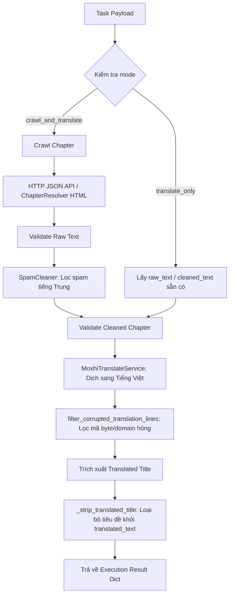

# TextExecutor — Tài Liệu Đặc Tả Kỹ Thuật

`TextExecutor` là Executor đảm nhiệm task stage `text` trong Worker (`distributed-video-system-worker`). Executor này hợp nhất toàn bộ chuỗi xử lý văn bản: **Thu thập (Crawl) -> Tiền xử lý & Làm sạch rác (SpamCleaner) -> Dịch thuật (Moxhi Translation) -> Hậu kiểm bản dịch (Corrupted Lines Filter)**.

---

## 1. Mục Đích & Vị Trí Trong Hệ Thống

Trước đây, worker phân tách thành nhiều executor nhỏ lẻ (`crawl_chapter`, `preprocess_text`, `translate_text`). `TextExecutor` được thiết kế để:
1. **Hợp nhất xử lý văn bản**: Giảm overhead chuyển giao task qua lại giữa Server và Worker.
2. **Làm sạch spam thông minh**: Tích hợp module AI `SpamCleaner` (Dual-Classifier) để loại bỏ quảng cáo, tên miền và đuôi watermark trước khi đưa vào dịch.
3. **Bảo vệ chất lượng bản dịch**: Tự động lọc các dòng dịch lỗi, mã byte hex (`<0x..>`), dấu thẻ lỗi (`><`), hoặc tên miền sót lại sau dịch.

---

## 2. Luồng Xử Lý (Workflow)



---

## 3. Đặc Tả Dữ Liệu Đầu Vào (Input Contract)

Executor nhận `task` (chứa `task.payload`) và `runtime_context` (kế thừa từ `BaseRuntimeContext`).

### Các trường trong `task.payload`:

| Tên trường | Kiểu dữ liệu | Bắt buộc | Mặc định | Mô tả |
| :--- | :--- | :--- | :--- | :--- |
| `mode` | `string` | Không | `"crawl_and_translate"` | Chế độ chạy: `"crawl_and_translate"` hoặc `"translate_only"`. |
| `source_url` | `string` | Có (nếu crawl) | `None` | URL trang truyện nguồn cần crawl. |
| `engine` / `render_engine` | `string` | Không | `"http"` | Engine crawl (`"http"`, `"playwright"`, ...). |
| `parser_type` | `string` | Không | `""` | Định dạng parser: `"json"` (cho API nguồn truyện) hoặc `"html"`. |
| `crawler_config` | `dict` | Không | `{}` | Cấu hình bộ chọn CSS: `css_title`, `css_content`, `css_next`. |
| `raw_text` | `string` | Có (nếu `translate_only` & chưa clean) | `""` | Văn bản gốc tiếng Trung. |
| `cleaned_text` | `string` | Không | `""` | Văn bản tiếng Trung đã làm sạch sẵn (nếu có). |
| `original_title` | `string` | Không | `""` | Tiêu đề chương gốc tiếng Trung. |
| `chapter_number` | `int` / `float` | Không | `None` | Số thứ tự chương (phục vụ logging / context). |

---

## 4. Đặc Tả Dữ Liệu Đầu Ra (Output Contract)

Khi thực thi thành công, phương thức `execute()` trả về một `dict` gồm các trường sau:

| Tên trường | Kiểu dữ liệu | Mô tả |
| :--- | :--- | :--- |
| `translated_text` | `str` | **Chỉ chứa phần nội dung chương** đã dịch sang tiếng Việt (đã bóc tách loại bỏ `translated_title`, lọc bỏ mã byte/dòng rác). Dùng cho TTS (`AudioExecutor`) để không bị đọc lặp tiêu đề. |
| `original_title` | `str` | Tiêu đề gốc của chương (tiếng Trung). |
| `translated_title` | `str` | Tiêu đề chương sau khi dịch sang tiếng Việt (được tách riêng độc lập). |
| `raw_text` | `str` | Toàn bộ văn bản gốc ban đầu (tiêu đề + nội dung thô trước khi làm sạch). |

---

## 5. Quy Trình Làm Sạch & Tách Biệt Tiêu Đề

### Lớp 1: Làm sạch văn bản tiếng Trung (Pre-translation)
- **`validate_raw_text(raw_text)`**: Kiểm tra ký tự lỗi encoding, ký tự thay thế `\ufffd`, tỷ lệ ký tự rác.
- **`SpamCleaner`**:
  - *Full-line Classifier*: Quét và xóa toàn bộ các dòng quảng cáo, web link, kêu gọi bình chọn (`添加書籤`, `ttks.tw`, `8book.com`).
  - *Tail-window Classifier*: Tự động phát hiện và cắt bỏ watermark chèn vào cuối các câu thoại mà không làm ảnh hưởng nội dung văn bản.
- **`validate_cleaned_chapter(cleaned_text)`**: Đảm bảo số lượng và tỷ lệ chữ Hán đạt ngưỡng tiêu chuẩn của một chương truyện hợp lệ.

### Lớp 2: Hậu kiểm bản dịch tiếng Việt (Post-translation)
- **`filter_corrupted_translation_lines(text)`**:
  - Bắt và loại bỏ các chuỗi mã byte hex lỗi của model dịch (dạng `<0x..>`, ví dụ: `<0xD0><0xB2>`).
  - Bắt chữ ký lỗi thẻ đụng đầu (`><`).
  - Bắt các dòng chỉ còn sót lại tên miền website rác (ví dụ: `8book.com`, `ttks.tw`).

### Tách biệt Tiêu Đề (`_strip_translated_title`)
- Tiêu đề gốc và nội dung được gửi cùng nhau vào `MoxhiTranslateService` nhằm tối ưu chất lượng ngữ cảnh và giảm số lần gọi API.
- Sau khi dịch, `translated_title` được trích xuất từ dòng đầu tiên.
- `_strip_translated_title` lập tức loại bỏ dòng tiêu đề này khỏi `translated_text` để đảm bảo `translated_text` chỉ chứa duy nhất phần văn bản nội dung kể chuyện, tránh việc `AudioExecutor` (TTS) đọc lặp tiêu đề ở đầu audio.

---

## 6. Xử Lý Ngoại Lệ (Exceptions)

- `ValueError("Missing source_url")`: Chế độ crawl nhưng thiếu URL nguồn.
- `ValueError("Resolve chapter failed")`: ChapterResolver không bóc tách được nội dung từ trang đích.
- `ValueError("Chapter empty")`: Nội dung văn bản sau khi crawl hoặc nhận vào bị rỗng.
- `ValueError("Missing raw_text/cleaned_text for translate_only mode")`: Thiếu văn bản đầu vào cho chế độ dịch thuần túy.
- `ValueError("Translated text is empty")`: Dịch vụ dịch trả về rỗng hoặc toàn bộ bản dịch bị lỗi lọc sạch.

---

## 7. Hướng Dẫn Kiểm Thử (Unit Tests)

Bộ unit test hoàn chỉnh cho executor nằm tại `tests/test_text_executor.py`.

Chạy kiểm thử:
```powershell
.venv\Scripts\python.exe -m unittest tests/test_text_executor.py
```
